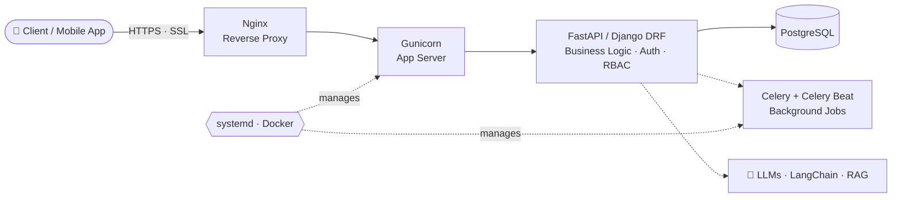

  
  
  
  

📍 Bhubaneswar, Odisha, India &nbsp;•&nbsp; 🎓 MCA · BPUT &nbsp;•&nbsp; 🟢 Open to Python / GenAI opportunities

---

## 👨‍💻 About Me

I'm a **Python Developer** who specializes in **GenAI, FastAPI, Django and full-stack development**. I design and ship **scalable backend systems and AI-powered applications**, from HRMS, CRM and accounting platforms to real-time attendance systems integrated with hardware sensors.

I own the whole lifecycle: **API design → database modelling → AI integration → production deployment**, with a strong focus on performance, security and reliability.

<table>
  <tr>
    <td width="33%" align="center">
      <h3>⚙️ Backend Engineering</h3>
      REST APIs, JWT auth, RBAC, PostgreSQL, SQLAlchemy, Alembic, Celery
    </td>
    <td width="33%" align="center">
      <h3>🧠 Generative AI</h3>
      LangChain, Google Gemini, Hugging Face, embeddings, RAG, AI agents
    </td>
    <td width="33%" align="center">
      <h3>🚀 DevOps & Deployment</h3>
      Linux, Docker, Nginx, Gunicorn, systemd, SSL, Hostinger VPS
    </td>
  </tr>
</table>

---

## 📈 Impact at a Glance

| 👥 Users Supported | ⚡ Workflow Efficiency | 🤖 Manual Effort Reduced | 🟢 Production Uptime |
|:---:|:---:|:---:|:---:|
| **1,000+** | **Up to 90%** | **Up to 60%** | **99%** |

---

## 🛠️ Tech Stack

**Languages · Frameworks · Databases · Tools**

 

**GenAI · Automation · Backend Libraries**

---

## 💼 Experience

### 🔹 Full Stack Backend Engineer (Python + DevOps) · [SomniateTech](#)
`Nov 2025 – Present`

- 🏗️ **Architected and deployed** scalable backends and AI apps with **Python, FastAPI, Django REST Framework, Node.js (Express.js) and LangChain**, including **HRMS, Employee Tracking (CRM), Accounting Software** and **real-time attendance systems integrated with hardware sensors**.
- 🤖 **Built an AI Client Discovery Agent** that identifies potential clients on LinkedIn, Upwork and Freelancer based on business requirements and service offerings.
- 🧠 **Developed GenAI applications** using LangChain, LLMs, Google Gemini, Hugging Face, embeddings, vector similarity search and **RAG pipelines** for context-aware chatbots and conversational agents.
- 🔐 **Delivered secure REST APIs** for web and mobile apps with authentication, database integration and efficient data processing.
- 🚀 **Owned end-to-end DevOps** and production deployments on Hostinger VPS using Docker, Nginx, Gunicorn and SSL.

### 🔹 DevOps Intern · [Technoshrine](#)
`Aug 2025 – Oct 2025`

- ⚡ Built and deployed an **automated chatbot with n8n**, integrating APIs and workflow automation to optimize business operations.
- 🐧 Worked with **Networking, Linux and Docker** for backend development, deployment and system management.

---

## 🏢 Client Projects (Backend)

| Project | What I Built | Stack |
|:--|:--|:--|
| 👥 **HRMS & Employee Tracking** | Attendance, tasks, tickets, face verification, role-based access | `Django DRF` `FastAPI` `PostgreSQL` |
| 🛗 **Lift Management System** | APIs for customers, lifts, task execution, attendance, location tracking, tickets, roles & auth | `FastAPI` `PostgreSQL` `SQLAlchemy` `Alembic` |
| 💰 **Accounting Management** | Secure accounting backend with authentication and RBAC | `Django DRF` `FastAPI` |
| 🏭 **TATA Steel Fraud Detection** | Backend services and API integrations for fraud detection | `Django DRF` `FastAPI` |
| 🤖 **AI Chatbots & Automation** | n8n chatbots, email extraction, real-time data processing | `n8n` `Python` `LangChain` |
| ⏱️ **Background Processing** | Task scheduling and asynchronous operations | `Celery` `Celery Beat` |

### 🏗️ Production Deployment Architecture

---

## ⭐ Personal & Featured Projects

<table>
  <tr>
    <td align="center" width="50%">
      
       Technician booking platform with real-time job status, ratings & reviews and role-based dashboards. 
      <code>React</code> · <code>Django</code> · <code>TailwindCSS</code>
    </td>
    <td align="center" width="50%">
      
       Image + text analysis (Hugging Face API) for disease insights and medicine recommendations. 
      <code>Django</code> · <code>React</code> · <code>ML</code>
    </td>
  </tr>
  <tr>
    <td align="center" width="50%">
      
       Expense tracking with AI-driven financial insights and trend analysis. 
      <code>Django</code> · <code>AI</code>
    </td>
    <td align="center" width="50%">
      
       Local voice assistant with system control, weather updates and more. 
      <code>Python</code>
    </td>
  </tr>
</table>

<b>🛡️ More projects</b>

 

- 🛡️ **Women Safety Application**: real-time location tracking, emergency alert system and secure authentication for rapid response *(Django)*
- ✅ **[Fullstack To-Do App](https://github.com/DRashmiRanjan/fullstack-todo-app)**: task manager with authentication and full CRUD *(Django, React)*

---

## 📊 GitHub Analytics

<picture>
  <source media="(prefers-color-scheme: dark)" srcset="https://github-readme-activity-graph.vercel.app/graph?username=DRashmiRanjan&bg_color=0D1117&color=9B6FD1&line=9B6FD1&point=FFFFFF&area=true&area_color=5B3A8C&hide_border=true" />
  
</picture>

---

## 🌱 Currently Exploring

- 🔬 Advanced **RAG architectures, AI agents and vector databases**
- ⚛️ **React** for building modern full-stack applications
- 🧪 **Testing, CI/CD** and deployment optimization

## 🎯 Goal

> Build real-world AI-based solutions and grow as a Python / GenAI engineer at a top tech company.

---

## 🤝 Let's Connect

I'm always open to discussing backend engineering, GenAI and new opportunities.

 

*"Transforming real-world problems into intelligent digital solutions."*

